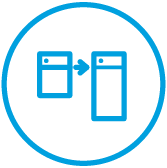

# MuleSoft Icons for PlantUML

A visual catalog of **138 PNG assets** for MuleSoft and integration architecture diagrams. All images are stored in the repository root and can be referenced individually from documentation or diagram-generation workflows.

> **Format:** The repository contains PNG images, not PlantUML `.puml` include files or macros. The gallery below previews the actual files; filenames and capitalization are preserved exactly.

## Browse by area

- [Anypoint Platform & MuleSoft products](#anypoint-platform-mulesoft-products) (12)
- [Integration, APIs & architecture](#integration-apis-architecture) (22)
- [Development & operations](#development-operations) (20)
- [Cloud providers, enterprise apps & services](#cloud-providers-enterprise-apps-services) (16)
- [Business, industries & outcomes](#business-industries-outcomes) (26)
- [People, learning & communications](#people-learning-communications) (17)
- [Devices, UI & miscellaneous](#devices-ui-miscellaneous) (25)

## Using an image

In Markdown, link to an icon in the repository:

```markdown

```

For external tools, use a raw URL (replace the filename with any entry from the gallery):

```text
https://raw.githubusercontent.com/jakubc78/MuleSoft-Icons-PUML/main/API_Manager.png
```

The filenames are case-sensitive in URLs. To inspect or download a full-resolution image, click its name beneath the thumbnail.

## Variant gallery

Every one of the 138 root icons has an RGBA PNG variant at **16, 24, 32, 48, and 64 pixels**, in each of nine themes. The image keeps its visible aspect ratio, is centered on a transparent square canvas, and uses the source filename unchanged. Choose a larger size for presentations or detailed artwork; 16 and 24 pixels work best for simpler shapes.

| Theme | Colour | Suggested diagram use |
|---|---|---|
| `original` | Source colours | Preserve the original artwork |
| `mono-dark` | `#212121` | Light backgrounds |
| `mono-light` | `#FFFFFF` | Dark backgrounds |
| `blue` | `#00A1DF` | Standard MuleSoft components |
| `grey` | `#808080` | Supporting infrastructure |
| `red` | `#E53935` | Failed or critical components |
| `green` | `#43A047` | Healthy components |
| `orange` | `#FB8C00` | Warnings or degraded state |
| `purple` | `#8E24AA` | External or special-purpose components |

These are suggested conventions for diagrams, not mandatory meanings. Keep a legend when colour carries status information.

### Compare themes

The same API Manager icon at 32 × 32 pixels:

| Original | Dark | Light | Blue | Grey | Red | Green | Orange | Purple |
|---|---|---|---|---|---|---|---|---|
|  |  |  |  |  |  |  |  |  |

The white preview is intended for a dark page or diagram background.

| API Manager | CloudHub | Anypoint MQ | Database | Salesforce | Runtime Manager |
|---|---|---|---|---|---|
|  |  |  |  |  |  |

### Browse variant directories

| Size | Original | Dark | Light | Blue | Grey | Red | Green | Orange | Purple |
|---|---|---|---|---|---|---|---|---|---|
| 16 | [original](variants/16/original/) | [mono-dark](variants/16/mono-dark/) | [mono-light](variants/16/mono-light/) | [blue](variants/16/blue/) | [grey](variants/16/grey/) | [red](variants/16/red/) | [green](variants/16/green/) | [orange](variants/16/orange/) | [purple](variants/16/purple/) |
| 24 | [original](variants/24/original/) | [mono-dark](variants/24/mono-dark/) | [mono-light](variants/24/mono-light/) | [blue](variants/24/blue/) | [grey](variants/24/grey/) | [red](variants/24/red/) | [green](variants/24/green/) | [orange](variants/24/orange/) | [purple](variants/24/purple/) |
| 32 | [original](variants/32/original/) | [mono-dark](variants/32/mono-dark/) | [mono-light](variants/32/mono-light/) | [blue](variants/32/blue/) | [grey](variants/32/grey/) | [red](variants/32/red/) | [green](variants/32/green/) | [orange](variants/32/orange/) | [purple](variants/32/purple/) |
| 48 | [original](variants/48/original/) | [mono-dark](variants/48/mono-dark/) | [mono-light](variants/48/mono-light/) | [blue](variants/48/blue/) | [grey](variants/48/grey/) | [red](variants/48/red/) | [green](variants/48/green/) | [orange](variants/48/orange/) | [purple](variants/48/purple/) |
| 64 | [original](variants/64/original/) | [mono-dark](variants/64/mono-dark/) | [mono-light](variants/64/mono-light/) | [blue](variants/64/blue/) | [grey](variants/64/grey/) | [red](variants/64/red/) | [green](variants/64/green/) | [orange](variants/64/orange/) | [purple](variants/64/purple/) |

### Use a variant

In Markdown, reference the size, theme, and exact filename:

```markdown


```

For PlantUML renderers that accept PNG image URLs, use the raw GitHub path. For example, these colours distinguish a standard MuleSoft service, its supporting database, an external Salesforce system, and a warning state:

```plantuml
@startuml
rectangle "<img:https://raw.githubusercontent.com/jakubc78/MuleSoft-Icons-PUML/main/variants/32/blue/API_Manager.png> API Manager" as api
database "<img:https://raw.githubusercontent.com/jakubc78/MuleSoft-Icons-PUML/main/variants/32/grey/Database.png> Database" as db
cloud "<img:https://raw.githubusercontent.com/jakubc78/MuleSoft-Icons-PUML/main/variants/32/purple/Salesforce.png> Salesforce" as sf
rectangle "<img:https://raw.githubusercontent.com/jakubc78/MuleSoft-Icons-PUML/main/variants/32/orange/Runtime_Manager.png> Runtime Manager (degraded)" as runtime
api --> db
api --> sf
api --> runtime
@enduml
```



The raw URLs above become available on `main` after this library is merged. Local PlantUML rendering can use downloaded image paths instead.

### Artwork limitations

The two wide files, `API.png` and `API_238x132.png`, contain an opaque white logo inside a blue shape. Their recoloured variants use a transparent logo cutout to keep the detail visible; this changes the original two-colour treatment. The `original` variants retain the source colours. At 16 × 16 and sometimes 24 × 24, small text and intricate interior details in complex icons, such as Salesforce, are limited by the available pixels. Each variant is a raster downsample, so increasing its display size will not recover detail.

## Image gallery

### Anypoint Platform & MuleSoft products

<table>
<tr>
<td align="center" width="25%"><a href="API.png"></a><br><sub><a href="API.png"><code>API.png</code></a></sub></td>
<td align="center" width="25%"><a href="API_238x132.png"></a><br><sub><a href="API_238x132.png"><code>API_238x132.png</code></a></sub></td>
<td align="center" width="25%"><a href="API_Manager.png"></a><br><sub><a href="API_Manager.png"><code>API_Manager.png</code></a></sub></td>
<td align="center" width="25%"><a href="Anypoint_MQ.png"></a><br><sub><a href="Anypoint_MQ.png"><code>Anypoint_MQ.png</code></a></sub></td>
</tr>
<tr>
<td align="center" width="25%"><a href="CloudHub.png"></a><br><sub><a href="CloudHub.png"><code>CloudHub.png</code></a></sub></td>
<td align="center" width="25%"><a href="DataWeave.png"></a><br><sub><a href="DataWeave.png"><code>DataWeave.png</code></a></sub></td>
<td align="center" width="25%"><a href="Exchange.png"></a><br><sub><a href="Exchange.png"><code>Exchange.png</code></a></sub></td>
<td align="center" width="25%"><a href="MuleSoft.png"></a><br><sub><a href="MuleSoft.png"><code>MuleSoft.png</code></a></sub></td>
</tr>
<tr>
<td align="center" width="25%"><a href="Runtime_Manager.png"></a><br><sub><a href="Runtime_Manager.png"><code>Runtime_Manager.png</code></a></sub></td>
<td align="center" width="25%"><a href="Studio.png"></a><br><sub><a href="Studio.png"><code>Studio.png</code></a></sub></td>
<td align="center" width="25%"><a href="Studio_200x200.png"></a><br><sub><a href="Studio_200x200.png"><code>Studio_200x200.png</code></a></sub></td>
<td align="center" width="25%"><a href="Analytics.png"></a><br><sub><a href="Analytics.png"><code>Analytics.png</code></a></sub></td>
</tr>
</table>

### Integration, APIs & architecture

<table>
<tr>
<td align="center" width="25%"><a href="Application_Network.png"></a><br><sub><a href="Application_Network.png"><code>Application_Network.png</code></a></sub></td>
<td align="center" width="25%"><a href="B2B.png"></a><br><sub><a href="B2B.png"><code>B2B.png</code></a></sub></td>
<td align="center" width="25%"><a href="Cloud2Cloud_Integration.png"></a><br><sub><a href="Cloud2Cloud_Integration.png"><code>Cloud2Cloud_Integration.png</code></a></sub></td>
<td align="center" width="25%"><a href="Connector.png"></a><br><sub><a href="Connector.png"><code>Connector.png</code></a></sub></td>
</tr>
<tr>
<td align="center" width="25%"><a href="Database.png"></a><br><sub><a href="Database.png"><code>Database.png</code></a></sub></td>
<td align="center" width="25%"><a href="Datalake.png"></a><br><sub><a href="Datalake.png"><code>Datalake.png</code></a></sub></td>
<td align="center" width="25%"><a href="Decouple.png"></a><br><sub><a href="Decouple.png"><code>Decouple.png</code></a></sub></td>
<td align="center" width="25%"><a href="Decouple_V2.png"></a><br><sub><a href="Decouple_V2.png"><code>Decouple_V2.png</code></a></sub></td>
</tr>
<tr>
<td align="center" width="25%"><a href="Events.png"></a><br><sub><a href="Events.png"><code>Events.png</code></a></sub></td>
<td align="center" width="25%"><a href="Flow-75.png"></a><br><sub><a href="Flow-75.png"><code>Flow-75.png</code></a></sub></td>
<td align="center" width="25%"><a href="Flow-88.png"></a><br><sub><a href="Flow-88.png"><code>Flow-88.png</code></a></sub></td>
<td align="center" width="25%"><a href="Hybrid.png"></a><br><sub><a href="Hybrid.png"><code>Hybrid.png</code></a></sub></td>
</tr>
<tr>
<td align="center" width="25%"><a href="Integrate.png"></a><br><sub><a href="Integrate.png"><code>Integrate.png</code></a></sub></td>
<td align="center" width="25%"><a href="IOT.png"></a><br><sub><a href="IOT.png"><code>IOT.png</code></a></sub></td>
<td align="center" width="25%"><a href="Layers.png"></a><br><sub><a href="Layers.png"><code>Layers.png</code></a></sub></td>
<td align="center" width="25%"><a href="LegacyModernization.png"></a><br><sub><a href="LegacyModernization.png"><code>LegacyModernization.png</code></a></sub></td>
</tr>
<tr>
<td align="center" width="25%"><a href="Message.png"></a><br><sub><a href="Message.png"><code>Message.png</code></a></sub></td>
<td align="center" width="25%"><a href="OmniChannels.png"></a><br><sub><a href="OmniChannels.png"><code>OmniChannels.png</code></a></sub></td>
<td align="center" width="25%"><a href="Router.png"></a><br><sub><a href="Router.png"><code>Router.png</code></a></sub></td>
<td align="center" width="25%"><a href="SaaS.png"></a><br><sub><a href="SaaS.png"><code>SaaS.png</code></a></sub></td>
</tr>
<tr>
<td align="center" width="25%"><a href="Server-Mainframe.png"></a><br><sub><a href="Server-Mainframe.png"><code>Server-Mainframe.png</code></a></sub></td>
<td align="center" width="25%"><a href="Transform.png"></a><br><sub><a href="Transform.png"><code>Transform.png</code></a></sub></td>
</tr>
</table>

### Development & operations

<table>
<tr>
<td align="center" width="25%"><a href="Align.png"></a><br><sub><a href="Align.png"><code>Align.png</code></a></sub></td>
<td align="center" width="25%"><a href="Architect.png"></a><br><sub><a href="Architect.png"><code>Architect.png</code></a></sub></td>
<td align="center" width="25%"><a href="Change.png"></a><br><sub><a href="Change.png"><code>Change.png</code></a></sub></td>
<td align="center" width="25%"><a href="Code.png"></a><br><sub><a href="Code.png"><code>Code.png</code></a></sub></td>
</tr>
<tr>
<td align="center" width="25%"><a href="Controls.png"></a><br><sub><a href="Controls.png"><code>Controls.png</code></a></sub></td>
<td align="center" width="25%"><a href="Design.png"></a><br><sub><a href="Design.png"><code>Design.png</code></a></sub></td>
<td align="center" width="25%"><a href="Design_V2.png"></a><br><sub><a href="Design_V2.png"><code>Design_V2.png</code></a></sub></td>
<td align="center" width="25%"><a href="Develop%26Test.png"></a><br><sub><a href="Develop%26Test.png"><code>Develop&amp;Test.png</code></a></sub></td>
</tr>
<tr>
<td align="center" width="25%"><a href="Drag_and_Drop.png"></a><br><sub><a href="Drag_and_Drop.png"><code>Drag_and_Drop.png</code></a></sub></td>
<td align="center" width="25%"><a href="Install.png"></a><br><sub><a href="Install.png"><code>Install.png</code></a></sub></td>
<td align="center" width="25%"><a href="Operate.png"></a><br><sub><a href="Operate.png"><code>Operate.png</code></a></sub></td>
<td align="center" width="25%"><a href="Scale.png"></a><br><sub><a href="Scale.png"><code>Scale.png</code></a></sub></td>
</tr>
<tr>
<td align="center" width="25%"><a href="Start-Execute.png"></a><br><sub><a href="Start-Execute.png"><code>Start-Execute.png</code></a></sub></td>
<td align="center" width="25%"><a href="Tools-Utility.png"></a><br><sub><a href="Tools-Utility.png"><code>Tools-Utility.png</code></a></sub></td>
<td align="center" width="25%"><a href="Validate.png"></a><br><sub><a href="Validate.png"><code>Validate.png</code></a></sub></td>
<td align="center" width="25%"><a href="Firewall.png"></a><br><sub><a href="Firewall.png"><code>Firewall.png</code></a></sub></td>
</tr>
<tr>
<td align="center" width="25%"><a href="Lock.png"></a><br><sub><a href="Lock.png"><code>Lock.png</code></a></sub></td>
<td align="center" width="25%"><a href="SecureCloud.png"></a><br><sub><a href="SecureCloud.png"><code>SecureCloud.png</code></a></sub></td>
<td align="center" width="25%"><a href="Security-67.png"></a><br><sub><a href="Security-67.png"><code>Security-67.png</code></a></sub></td>
<td align="center" width="25%"><a href="Security-85.png"></a><br><sub><a href="Security-85.png"><code>Security-85.png</code></a></sub></td>
</tr>
</table>

### Cloud providers, enterprise apps & services

<table>
<tr>
<td align="center" width="25%"><a href="Aws.png"></a><br><sub><a href="Aws.png"><code>Aws.png</code></a></sub></td>
<td align="center" width="25%"><a href="Azure.png"></a><br><sub><a href="Azure.png"><code>Azure.png</code></a></sub></td>
<td align="center" width="25%"><a href="Box.png"></a><br><sub><a href="Box.png"><code>Box.png</code></a></sub></td>
<td align="center" width="25%"><a href="Cisco.png"></a><br><sub><a href="Cisco.png"><code>Cisco.png</code></a></sub></td>
</tr>
<tr>
<td align="center" width="25%"><a href="Facebook.png"></a><br><sub><a href="Facebook.png"><code>Facebook.png</code></a></sub></td>
<td align="center" width="25%"><a href="Github.png"></a><br><sub><a href="Github.png"><code>Github.png</code></a></sub></td>
<td align="center" width="25%"><a href="Jira.png"></a><br><sub><a href="Jira.png"><code>Jira.png</code></a></sub></td>
<td align="center" width="25%"><a href="LinkedIN.png"></a><br><sub><a href="LinkedIN.png"><code>LinkedIN.png</code></a></sub></td>
</tr>
<tr>
<td align="center" width="25%"><a href="Marketo.png"></a><br><sub><a href="Marketo.png"><code>Marketo.png</code></a></sub></td>
<td align="center" width="25%"><a href="Netscape.png"></a><br><sub><a href="Netscape.png"><code>Netscape.png</code></a></sub></td>
<td align="center" width="25%"><a href="SAP.png"></a><br><sub><a href="SAP.png"><code>SAP.png</code></a></sub></td>
<td align="center" width="25%"><a href="Salesforce.png"></a><br><sub><a href="Salesforce.png"><code>Salesforce.png</code></a></sub></td>
</tr>
<tr>
<td align="center" width="25%"><a href="ServiceNow.png"></a><br><sub><a href="ServiceNow.png"><code>ServiceNow.png</code></a></sub></td>
<td align="center" width="25%"><a href="Twitter.png"></a><br><sub><a href="Twitter.png"><code>Twitter.png</code></a></sub></td>
<td align="center" width="25%"><a href="Workday.png"></a><br><sub><a href="Workday.png"><code>Workday.png</code></a></sub></td>
<td align="center" width="25%"><a href="X.png"></a><br><sub><a href="X.png"><code>X.png</code></a></sub></td>
</tr>
</table>

### Business, industries & outcomes

<table>
<tr>
<td align="center" width="25%"><a href="5X.png"></a><br><sub><a href="5X.png"><code>5X.png</code></a></sub></td>
<td align="center" width="25%"><a href="Accelerate.png"></a><br><sub><a href="Accelerate.png"><code>Accelerate.png</code></a></sub></td>
<td align="center" width="25%"><a href="Accelerate_V1.png"></a><br><sub><a href="Accelerate_V1.png"><code>Accelerate_V1.png</code></a></sub></td>
<td align="center" width="25%"><a href="Accelerate_V2.png"></a><br><sub><a href="Accelerate_V2.png"><code>Accelerate_V2.png</code></a></sub></td>
</tr>
<tr>
<td align="center" width="25%"><a href="Building.png"></a><br><sub><a href="Building.png"><code>Building.png</code></a></sub></td>
<td align="center" width="25%"><a href="Business_Automation.png"></a><br><sub><a href="Business_Automation.png"><code>Business_Automation.png</code></a></sub></td>
<td align="center" width="25%"><a href="Car.png"></a><br><sub><a href="Car.png"><code>Car.png</code></a></sub></td>
<td align="center" width="25%"><a href="CreditCard.png"></a><br><sub><a href="CreditCard.png"><code>CreditCard.png</code></a></sub></td>
</tr>
<tr>
<td align="center" width="25%"><a href="Customer_Success.png"></a><br><sub><a href="Customer_Success.png"><code>Customer_Success.png</code></a></sub></td>
<td align="center" width="25%"><a href="Deliver.png"></a><br><sub><a href="Deliver.png"><code>Deliver.png</code></a></sub></td>
<td align="center" width="25%"><a href="FInancialService.png"></a><br><sub><a href="FInancialService.png"><code>FInancialService.png</code></a></sub></td>
<td align="center" width="25%"><a href="Global.png"></a><br><sub><a href="Global.png"><code>Global.png</code></a></sub></td>
</tr>
<tr>
<td align="center" width="25%"><a href="Government.png"></a><br><sub><a href="Government.png"><code>Government.png</code></a></sub></td>
<td align="center" width="25%"><a href="Healthcare-12.png"></a><br><sub><a href="Healthcare-12.png"><code>Healthcare-12.png</code></a></sub></td>
<td align="center" width="25%"><a href="Healthcare-58.png"></a><br><sub><a href="Healthcare-58.png"><code>Healthcare-58.png</code></a></sub></td>
<td align="center" width="25%"><a href="LeadPOV.png"></a><br><sub><a href="LeadPOV.png"><code>LeadPOV.png</code></a></sub></td>
</tr>
<tr>
<td align="center" width="25%"><a href="LowerCost.png"></a><br><sub><a href="LowerCost.png"><code>LowerCost.png</code></a></sub></td>
<td align="center" width="25%"><a href="Loyalty.png"></a><br><sub><a href="Loyalty.png"><code>Loyalty.png</code></a></sub></td>
<td align="center" width="25%"><a href="Money-Finance.png"></a><br><sub><a href="Money-Finance.png"><code>Money-Finance.png</code></a></sub></td>
<td align="center" width="25%"><a href="Partners.png"></a><br><sub><a href="Partners.png"><code>Partners.png</code></a></sub></td>
</tr>
<tr>
<td align="center" width="25%"><a href="Shopping_Cart-Retail.png"></a><br><sub><a href="Shopping_Cart-Retail.png"><code>Shopping_Cart-Retail.png</code></a></sub></td>
<td align="center" width="25%"><a href="Technology.png"></a><br><sub><a href="Technology.png"><code>Technology.png</code></a></sub></td>
<td align="center" width="25%"><a href="Telecom.png"></a><br><sub><a href="Telecom.png"><code>Telecom.png</code></a></sub></td>
<td align="center" width="25%"><a href="Vision.png"></a><br><sub><a href="Vision.png"><code>Vision.png</code></a></sub></td>
</tr>
<tr>
<td align="center" width="25%"><a href="Reuse-V1.png"></a><br><sub><a href="Reuse-V1.png"><code>Reuse-V1.png</code></a></sub></td>
<td align="center" width="25%"><a href="Reuse-V2.png"></a><br><sub><a href="Reuse-V2.png"><code>Reuse-V2.png</code></a></sub></td>
</tr>
</table>

### People, learning & communications

<table>
<tr>
<td align="center" width="25%"><a href="24Hrs.png"></a><br><sub><a href="24Hrs.png"><code>24Hrs.png</code></a></sub></td>
<td align="center" width="25%"><a href="Cartification.png"></a><br><sub><a href="Cartification.png"><code>Cartification.png</code></a></sub></td>
<td align="center" width="25%"><a href="Ebook.png"></a><br><sub><a href="Ebook.png"><code>Ebook.png</code></a></sub></td>
<td align="center" width="25%"><a href="Education.png"></a><br><sub><a href="Education.png"><code>Education.png</code></a></sub></td>
</tr>
<tr>
<td align="center" width="25%"><a href="Email.png"></a><br><sub><a href="Email.png"><code>Email.png</code></a></sub></td>
<td align="center" width="25%"><a href="Instructor-Led.png"></a><br><sub><a href="Instructor-Led.png"><code>Instructor-Led.png</code></a></sub></td>
<td align="center" width="25%"><a href="MultiUser.png"></a><br><sub><a href="MultiUser.png"><code>MultiUser.png</code></a></sub></td>
<td align="center" width="25%"><a href="News.png"></a><br><sub><a href="News.png"><code>News.png</code></a></sub></td>
</tr>
<tr>
<td align="center" width="25%"><a href="Self-Study.png"></a><br><sub><a href="Self-Study.png"><code>Self-Study.png</code></a></sub></td>
<td align="center" width="25%"><a href="SocialSharing.png"></a><br><sub><a href="SocialSharing.png"><code>SocialSharing.png</code></a></sub></td>
<td align="center" width="25%"><a href="Support.png"></a><br><sub><a href="Support.png"><code>Support.png</code></a></sub></td>
<td align="center" width="25%"><a href="Talking.png"></a><br><sub><a href="Talking.png"><code>Talking.png</code></a></sub></td>
</tr>
<tr>
<td align="center" width="25%"><a href="Training.png"></a><br><sub><a href="Training.png"><code>Training.png</code></a></sub></td>
<td align="center" width="25%"><a href="UserFemale.png"></a><br><sub><a href="UserFemale.png"><code>UserFemale.png</code></a></sub></td>
<td align="center" width="25%"><a href="UserMale.png"></a><br><sub><a href="UserMale.png"><code>UserMale.png</code></a></sub></td>
<td align="center" width="25%"><a href="Video-Play.png"></a><br><sub><a href="Video-Play.png"><code>Video-Play.png</code></a></sub></td>
</tr>
<tr>
<td align="center" width="25%"><a href="Like-Thankyou.png"></a><br><sub><a href="Like-Thankyou.png"><code>Like-Thankyou.png</code></a></sub></td>
</tr>
</table>

### Devices, UI & miscellaneous

<table>
<tr>
<td align="center" width="25%"><a href="ADP.png"></a><br><sub><a href="ADP.png"><code>ADP.png</code></a></sub></td>
<td align="center" width="25%"><a href="Alert-Warning.png"></a><br><sub><a href="Alert-Warning.png"><code>Alert-Warning.png</code></a></sub></td>
<td align="center" width="25%"><a href="Apps.png"></a><br><sub><a href="Apps.png"><code>Apps.png</code></a></sub></td>
<td align="center" width="25%"><a href="Cloud.png"></a><br><sub><a href="Cloud.png"><code>Cloud.png</code></a></sub></td>
</tr>
<tr>
<td align="center" width="25%"><a href="Compass.png"></a><br><sub><a href="Compass.png"><code>Compass.png</code></a></sub></td>
<td align="center" width="25%"><a href="Desktop.png"></a><br><sub><a href="Desktop.png"><code>Desktop.png</code></a></sub></td>
<td align="center" width="25%"><a href="Download.png"></a><br><sub><a href="Download.png"><code>Download.png</code></a></sub></td>
<td align="center" width="25%"><a href="Enhance.png"></a><br><sub><a href="Enhance.png"><code>Enhance.png</code></a></sub></td>
</tr>
<tr>
<td align="center" width="25%"><a href="File.png"></a><br><sub><a href="File.png"><code>File.png</code></a></sub></td>
<td align="center" width="25%"><a href="Home.png"></a><br><sub><a href="Home.png"><code>Home.png</code></a></sub></td>
<td align="center" width="25%"><a href="Hosted_by_MS.png"></a><br><sub><a href="Hosted_by_MS.png"><code>Hosted_by_MS.png</code></a></sub></td>
<td align="center" width="25%"><a href="Laptop.png"></a><br><sub><a href="Laptop.png"><code>Laptop.png</code></a></sub></td>
</tr>
<tr>
<td align="center" width="25%"><a href="LightBulb.png"></a><br><sub><a href="LightBulb.png"><code>LightBulb.png</code></a></sub></td>
<td align="center" width="25%"><a href="Location.png"></a><br><sub><a href="Location.png"><code>Location.png</code></a></sub></td>
<td align="center" width="25%"><a href="Log_Out.png"></a><br><sub><a href="Log_Out.png"><code>Log_Out.png</code></a></sub></td>
<td align="center" width="25%"><a href="Mobile.png"></a><br><sub><a href="Mobile.png"><code>Mobile.png</code></a></sub></td>
</tr>
<tr>
<td align="center" width="25%"><a href="MS_Iconography_MS_Core_Blue_40x40-110.png"></a><br><sub><a href="MS_Iconography_MS_Core_Blue_40x40-110.png"><code>MS_Iconography_MS_Core_Blue_40x40-110.png</code></a></sub></td>
<td align="center" width="25%"><a href="PDF.png"></a><br><sub><a href="PDF.png"><code>PDF.png</code></a></sub></td>
<td align="center" width="25%"><a href="Rocket.png"></a><br><sub><a href="Rocket.png"><code>Rocket.png</code></a></sub></td>
<td align="center" width="25%"><a href="Science.png"></a><br><sub><a href="Science.png"><code>Science.png</code></a></sub></td>
</tr>
<tr>
<td align="center" width="25%"><a href="Search.png"></a><br><sub><a href="Search.png"><code>Search.png</code></a></sub></td>
<td align="center" width="25%"><a href="Smart-Watch.png"></a><br><sub><a href="Smart-Watch.png"><code>Smart-Watch.png</code></a></sub></td>
<td align="center" width="25%"><a href="Success.png"></a><br><sub><a href="Success.png"><code>Success.png</code></a></sub></td>
<td align="center" width="25%"><a href="Tablet.png"></a><br><sub><a href="Tablet.png"><code>Tablet.png</code></a></sub></td>
</tr>
<tr>
<td align="center" width="25%"><a href="Webpage.png"></a><br><sub><a href="Webpage.png"><code>Webpage.png</code></a></sub></td>
</tr>
</table>

---

**Catalog coverage:** 138 of 138 PNG files present in the repository as of this update. To add new icons, commit the PNG and add it to the appropriate gallery group.
